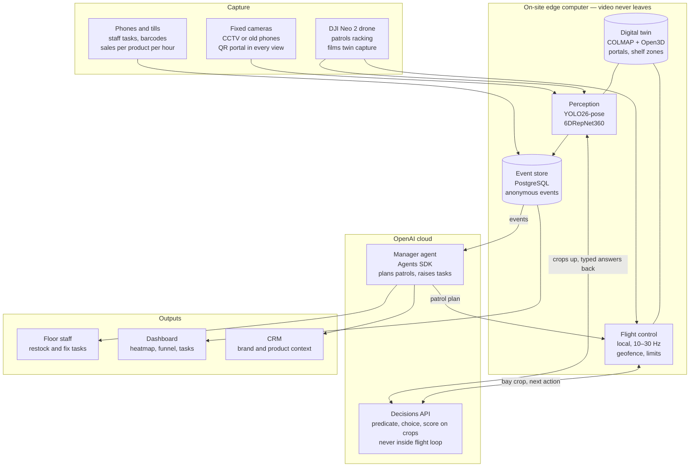

# Sentinel — Spatial AI for warehouses and retail

**Project spec and engineering brief for Devin**
Version 0.1 · 1 November 2026 · Owner: Zak

> Replace `Sentinel` everywhere once the name is final.

---

## 0. Read this first (instructions for Devin)

You are building a prototype of a spatial AI system for warehouses and stores. Cameras and an autonomous drone observe the floor. A shared 3D digital twin gives every observation a position in metres. The OpenAI Decisions API makes small judgement calls on image crops. An agent turns findings into staff tasks and CRM context.

### What to build first

**Milestones 1 to 3 (Section 10), with no drone.** Use webcams or pre-recorded video. The drone work (Section 8) is a separate, time-boxed track. It must never block the camera platform.

### Ground rules

**Do**
- Use Python 3.11+ with type hints, `pytest` tests, and `ruff` formatting.
- Keep all video and image processing on the local machine (the "edge").
- Send only small crops to the Decisions API, with faces blurred first.
- Store every event in twin coordinates (metres), per the event schema in Section 5.4.
- Make every threshold, camera, portal and zone configurable in `config/site.yaml`.
- Write a short README for each module with run instructions.
- Use Mermaid in docs for diagrams.

**Do not**
- Use `aukilabs/experimental-modules`, or anything that logs into the Auki network or loads Auki-hosted domains. Only `aukilabs/qr-lab` and `aukilabs/pnp-lab` are allowed; they are standalone MIT libraries.
- Store faces, run face recognition, or keep any identity across visits.
- Put any AI or network call inside the drone flight-control loop.
- Modify drone firmware, or disable or bypass any DJI safety feature (obstacle sensing, geofencing, altitude or speed limits, return-to-home).
- Commit secrets. `OPENAI_API_KEY` comes from the environment or `.env`, which is git-ignored.
- Upload raw video or full frames to any cloud service.

### Definition of done for the first delivery

Given a recorded video of a person at a shelf and a calibrated camera with a QR portal in view, the system:
1. solves the camera's position in twin coordinates;
2. places the person on the floor plan;
3. renders a live "looked" heatmap on the shelf zones;
4. emits `look`, `pick_up`, `put_back` and `kept` events into PostgreSQL;
5. shows all of this on a local three.js dashboard.

---

## 1. Summary

We are building a spatial AI layer that turns ordinary cameras and an autonomous drone into live floor intelligence for warehouses and stores. It shows where shoppers look and what they pick up, put back and buy. It also shows what the site needs: low stock, misplaced items and hazards, routed to people, robots and cloud agents.

It follows the approach Auki's **Cactus** showed in September 2026 (existing CCTV plus a phone-scanned digital twin, producing a shelf-attention heatmap), with four differences:

- **A full shopper funnel**, not just attention: looked, interested, picked up, put back, kept, sold.
- **An AI manager** that turns what the cameras see into staff tasks, reorder suggestions and CRM updates.
- **An autonomous drone patrol** (DJI Neo 2) for what fixed cameras can't cover, such as high racking and end-of-day rounds.
- **Fully self-owned**: open-source perception, our own digital twin, no Auki network. The OpenAI Decisions API makes the judgement calls.

The first milestone is a **filmed warehouse demo**. A mock retail aisle runs the live shopper funnel while the drone flies an autonomous stock-check patrol along the racking, both shown on one 3D map.

---

## 2. Background: the reference build we are extending

### 2.1 What Cactus showed

- **Cactus** is Auki Labs' "AI copilot for the built retail environment" ([getcactus.ai](https://www.getcactus.ai/)). Its public features:
  - a 3D shelf analytics dashboard
  - spatial task management
  - product search with route optimisation
  - integrations with existing sales and inventory systems
  - self-hosting on the customer's cloud
- **Setup:** QR "portals" are placed around the store, a phone scan creates the digital twin, and products are registered by scanning barcodes.
- **The demo:** on 21 September 2026, Auki's CEO Nils Pihl posted a demo showing which part of a shelf gets customer attention, using normal CCTV cameras and a phone-made digital twin ([post](https://x.com/broodsugar/status/2101979676050674161)). He added that it only stores *what* was looked at, not *who* was looking.
- **Pushback in the replies:** a former store manager pointed out that shelf stock moves constantly. The answer was that brands pay a premium for shelf space with more eye traffic.

### 2.2 How it was built (12-part thread by @solar_axons, Auki devrel)

Source: [thread start](https://x.com/solar_axons/status/2102084705151811666). Summarised step by step; this is the pipeline we replicate, minus the Auki network:

1. **Digital twin as coordinate system.** The twin defines the supermarket's local coordinate space and structure, hosted on edge compute (demo domain "XMart").
2. **QR markers as anchors.** QR codes of known size and pose in the twin anchor the digital layer to the real room. The point cloud and meshes came from phone videos, reconstructed on a local GPU machine with Auki's DMT app. *We replace this with COLMAP and Open3D (Section 6).*
3. **Twin loading** used `aukilabs/experimental-modules` for authentication. *We drop this and load our own twin from local files.*
4. **Cameras.** Four security cameras (one was a phone) stream RTMP/RTSP over the local network to the edge computer. The Auki SDK formed a local peer-to-peer cluster of cameras, edge compute and web viewer. *We use plain RTSP plus our own local services.*
5. **Camera pose.** Each camera has a QR marker in view. Detecting its corners, knowing its size and its position in the twin gives the camera's pose via perspective-n-point (PnP). Helper repos: [qr-lab](https://github.com/aukilabs/qr-lab) and [pnp-lab](https://github.com/aukilabs/pnp-lab).
6. **Intrinsics.** A basic OpenCV chessboard calibration gives each camera's intrinsics. Then any 2D pixel becomes a 3D ray in the twin.
7. **Body pose.** YOLO26n-pose gives 17 COCO keypoints including both ankles, which is a scale-invariant 2D pose.
8. **3D position.** Casting the ankle rays against the floor resolves the scale ambiguity, giving the person's 3D position and height in the twin.
9. **Head direction.** 6DRepNet360 gives head orientation in 3D. Measured accuracy was about 4 to 12°, better when the face is visible.
10. **Heatmap.** A cone is cast from the head pose into the point cloud, and the points hit most often over time form the heatmap.
11. **Stack:** Rust backend, axum for HTTP routing, three.js for the 3D scene, ffmpeg for video, built with Claude Code.
12. **Privacy:** no personally identifiable data is detected or collected, and data never leaves the premises.

### 2.3 Related builds referenced

- **Monocular navigation on a Unitree R1:** YOLO26n plus MoGe produce real-time depth maps and floorplans from a single camera on CPU ([post](https://x.com/Alacritic_Super/status/2116585410277306491)). Relevant if we ever need depth without markers.
- **NVIDIA SimReady assets for the browser:** 2,595 3D models optimised from 225 GB to 3.8 GB as GLB, dataset `codepawl/simready-glb` on Hugging Face ([post](https://x.com/anxuanng/status/2116504653215248436)). Useful for placeholder warehouse props in the three.js dashboard (check the asset licence).
- **DJI Mavic security drone:** built on the official DJI Mobile SDK v5 with on-phone YOLO, a Kalman tracker, Virtual Stick at 10 Hz and hard-coded safety rules ([post](https://x.com/0xCodez/status/2114762819371680110), [full prompt](https://x.com/0xCodez/status/2114762823762952307)). Its safety structure is a good model: simulator first, hard limits in code, human approval for every flight.

---

## 3. Problem and opportunity

Retail and warehouse systems record transactions, not what happens on the floor:
- **Point-of-sale** shows what sold.
- **The warehouse management system** shows where stock should be.
- **The CRM** holds accounts.

None of them see the shopper who compared two brands and walked away, the item picked up and put back, or the empty pick face nobody has logged yet.

That missing "in real life" context is valuable to three buyers:
- **Brands** pay a premium for shelf space with more eye traffic, and want to know why a product gets attention but not sales.
- **Retailers** want fewer empty shelves and less staff time spent walking aisles to check.
- **Warehouse operators** want inventory accuracy without manual cycle counts, especially on high racking.

The timing works because the parts are now cheap. Small open models run on a laptop, and the OpenAI Decisions API makes per-event judgement calls on images affordable: $0.10 per million input tokens, with output not charged.

---

## 4. Product

### 4.1 Pillars

All four pillars share one digital twin and one coordinate system.

1. **Shopper funnel analytics (fixed cameras).** Anonymous body pose and head direction give the attention heatmap and a per-product funnel: looked, interested, picked up, put back, kept, sold. Sales come from joining shelf events with till data, not from video.
2. **AI manager.** It watches for low stock, empty facings, misplaced items, missing labels, blocked aisles and spills. Each finding becomes a staff task, a reorder suggestion or an escalation, ranked by severity.
3. **Autonomous drone patrol.** Scheduled rounds when the floor is quiet. It checks high racking and bays outside camera view, and refreshes the twin. It never tracks shoppers.
4. **Agents and CRM.** Cloud agents read the event stream, answer questions such as "which shelf underperformed this week?", and write context to CRM records for brands, products and locations, never individual shoppers.

### 4.2 Metrics

Every metric is counted per product and per shelf zone, per hour, and never per person.

**Shopper funnel (fixed cameras)**

| Stage | Definition | Signal | Decisions API |
| --- | --- | --- | --- |
| Passed by | A tracked person enters the aisle zone | Body pose plus floor position from the ankles | None |
| Looked | Head-direction cone hits a shelf zone for at least `look_min_s` (default 1.5 s) | 6DRepNet360 head direction cast against the twin | None |
| Interested | Dwell of at least `interest_min_s` (default 5 s), facing the shelf, stepping closer | Track history | Optional `engagement_level` |
| Picked up | A wrist enters a shelf zone and a product leaves it | Wrist keypoints plus a change in the shelf crop | `holding_product` |
| Put back | The item returns to the shelf | Shelf crop after the reach | `reach_outcome` |
| Kept | The item goes into a basket or hand and leaves the zone | Shelf crop after the reach | `reach_outcome` |
| Sold | Till sales for that product in the same hour | Join with point-of-sale data | None |

- **On "churn":** in retail it usually means customers who stop coming back, which anonymous cameras can't see. The shelf-level metric we report is the **put-back rate**: picked up but not kept.
- **Headline brand metric:** **attention to sale**, meaning looks, pick-ups, kept and sold for each product.

**AI manager KPIs (fixed cameras and drone)**

| KPI | Definition | Source | Action |
| --- | --- | --- | --- |
| On-shelf availability | Share of facings or pick faces with stock | Fixed cameras for the floor, drone for racking | Restock task |
| Time to restock | Minutes from an empty facing detected to filled | Event log | Escalate when over target |
| Misplaced items | Products found away from their assigned location | Drone patrol, fixed cameras | Move task |
| Label issues | Missing or unreadable shelf or location labels | Drone patrol, fixed cameras | Fix task |
| Hazards | Spills, obstructions, blocked aisles or exits | Fixed cameras | Urgent task |
| Patrol coverage | Share of bays checked per round | Drone log | Reschedule missed bays |

Worker tracking is **out of scope**. Staff appear only as "someone in the zone" for safety checks, never as performance metrics.

### 4.3 Warehouse demo scenario

The demo runs in one warehouse with two zones: racking for the drone patrol and a mock retail aisle for the shopper funnel. Shoppers don't belong in a working warehouse, so the retail aisle is a set built at one end.

**Setup**
- **Racking zone:** 3 to 4 bays with location codes, one planted empty pick face and one misplaced carton.
- **Retail set:** one shelving unit with about 20 products that have barcodes and prices.
- **Cameras:** 4 fixed cameras (old phones or IP cameras on poles), each with a QR portal in view.
- **Portals:** printed QR markers of a known size, at measured positions.
- **Compute:** an edge laptop with a GPU on the local network, plus the drone.
- **People:** 3 to 4 actors as shoppers, one staff member, and one safety spotter.

**Script**
1. Open on the 3D twin with cameras and portals placed in it.
2. Actors shop. The heatmap builds live and the funnel counters tick up. One actor picks up an item and puts it back, and a `put_back` event appears with its confidence.
3. Dashboard: one product is flagged "high attention, low conversion".
4. A fixed camera spots the empty pick face. The manager agent creates a restock task, which arrives on the staff member's phone.
5. The agent sends the drone on a patrol. It takes off, positions itself from the portals and checks each bay. The overlay shows each decision, including the misplaced carton. Then it returns and lands.
6. The agent posts a shift summary: open tasks, a reorder suggestion, and a CRM note for the brand account.
7. Close on privacy: no faces stored, no identities, and video never leaves the site, only small crops.

---

## 5. System architecture

### 5.1 Overview



### 5.2 Three loops, three speeds

1. **Flight loop (local, 10 to 30 Hz).** Deterministic code sends movement commands and enforces the geofence and limits. No AI and no network calls run here.
2. **Decision loop (about once per event or bay).** The Decisions API answers one typed question. The flight loop can always override it. If no answer arrives within 2 s, the drone holds position.
3. **Mission loop (minutes).** The manager agent plans patrols, groups findings, and writes tasks and CRM updates.

### 5.3 Coordinate frames

- **Twin frame** (`twin`): metres, right-handed, Z up, origin at portal `P0`, X along the main aisle. Every event uses this frame.
- **Camera frame** (`cam_<id>`): OpenCV convention (X right, Y down, Z forward). The camera pose `T_twin_cam` comes from PnP against a portal.
- **Portal frame** (`portal_<id>`): origin at the QR code's centre, Z out of the code's face. Its pose `T_twin_portal` is measured once at setup and stored in `site.yaml`.
- **Drone frame** (`drone`): its pose `T_twin_drone` comes from PnP against any visible portal, smoothed with a constant-velocity Kalman filter.

### 5.4 Event schema (PostgreSQL)

```sql
CREATE TABLE events (
  event_id     TEXT PRIMARY KEY,            -- ULID
  ts           TIMESTAMPTZ NOT NULL,        -- UTC
  site_id      TEXT NOT NULL,
  zone_id      TEXT NOT NULL,               -- e.g. 'aisle-A-shelf-2' or 'bay-B-03'
  type         TEXT NOT NULL,               -- pass_by | look | interest | pick_up | put_back | kept | bay_issue | hazard | task | patrol
  product_id   TEXT,                        -- SKU or barcode when known
  x            DOUBLE PRECISION,            -- metres, twin frame
  y            DOUBLE PRECISION,
  z            DOUBLE PRECISION,
  source       TEXT NOT NULL,               -- 'camera-3' | 'drone' | 'pos' | 'agent'
  track_id     TEXT,                        -- short-lived, dropped when the person leaves; never linked across visits
  decision     JSONB,                       -- full Decisions API answer when one was made
  confidence   DOUBLE PRECISION,
  crop_ref     TEXT,                        -- local file path only; never a cloud URL
  payload      JSONB                        -- anything type-specific
);
CREATE INDEX events_zone_ts ON events (zone_id, ts);
CREATE INDEX events_type_ts ON events (type, ts);

CREATE TABLE tasks (
  task_id      TEXT PRIMARY KEY,
  created_at   TIMESTAMPTZ NOT NULL,
  zone_id      TEXT NOT NULL,
  kind         TEXT NOT NULL,               -- restock | move | fix_label | hazard | review
  severity     DOUBLE PRECISION,            -- issue_severity score
  status       TEXT NOT NULL DEFAULT 'open',-- open | in_progress | done | dismissed
  source_event TEXT REFERENCES events(event_id),
  assignee     TEXT,
  note         TEXT
);

CREATE TABLE sales (                        -- imported from point-of-sale
  ts_hour      TIMESTAMPTZ NOT NULL,
  product_id   TEXT NOT NULL,
  units        INTEGER NOT NULL,
  PRIMARY KEY (ts_hour, product_id)
);
```

### 5.5 Site configuration (`config/site.yaml`, example)

```yaml
site_id: demo-warehouse
units: metres
floor_plane: [0.0, 0.0, 1.0, 0.0]          # ax+by+cz+d=0, filled by twin tooling

portals:
  - id: P0
    size_m: 0.20                           # printed edge length of the QR code
    T_twin_portal:                          # 4x4, row-major; P0 is the origin
      [1,0,0,0, 0,1,0,0, 0,0,1,0, 0,0,0,1]
  - id: P1
    size_m: 0.20
    T_twin_portal: [ ... measured ... ]

cameras:
  - id: camera-1
    url: rtsp://192.168.1.21:8554/stream
    intrinsics_file: calib/camera-1.yaml   # from chessboard calibration
    anchor_portal: P1
    fps: 15

zones:
  - id: aisle-A-shelf-2
    kind: retail_shelf
    polygon_xy: [[1.0,2.0],[3.0,2.0],[3.0,2.4],[1.0,2.4]]
    z_range: [0.0, 1.8]
    products: [SKU123, SKU124]
  - id: bay-B-03
    kind: rack_bay
    polygon_xy: [[...]]
    z_range: [0.0, 6.0]
    reference_image: refs/bay-B-03.jpg

thresholds:
  look_min_s: 1.5
  interest_min_s: 5.0
  holding_product: {auto: 0.85, review: 0.55}
  reach_outcome:   {auto: 0.80, review: 0.50}
  bay_issue:       {auto: 0.85, review: 0.55}
  decision_timeout_s: 2.0

drone:
  geofence_polygon_xy: [[...]]
  max_alt_m: 4.0
  max_speed_mps: 1.0
  min_battery_pct: 30
  min_dist_people_m: 3.0
```

All thresholds above are **starting values** to be tuned on labelled clips (Section 11).

---

## 6. Tech stack, repos and how to use them

### 6.1 Stack and licences

| Layer | Component | Role | Licence |
| --- | --- | --- | --- |
| Reconstruction | [COLMAP](https://colmap.github.io/) | Video frames to a 3D point cloud | BSD |
| Photoreal view (optional) | Nerfstudio or gsplat | Gaussian-splat view for the demo | Apache-2.0 |
| Twin processing | Open3D | Floor plane, zones, alignment | MIT |
| Markers | [aukilabs/qr-lab](https://github.com/aukilabs/qr-lab) | QR portal corners at sub-pixel accuracy, fisheye support | MIT |
| Positioning | [aukilabs/pnp-lab](https://github.com/aukilabs/pnp-lab) | Camera and drone pose from portals | MIT |
| Calibration and fallback | OpenCV | Lens calibration; `QRCodeDetector` and `solvePnP` fallback | Apache-2.0 |
| People | [Ultralytics YOLO26-pose](https://github.com/ultralytics/ultralytics) | 17 COCO keypoints | AGPL-3.0 or paid Enterprise |
| Head direction | [6DRepNet360](https://github.com/thohemp/6DRepNet360) | Full-range head orientation | MIT code; check the weights' dataset terms |
| Judgement | [OpenAI Decisions API](https://developers.openai.com/api/docs/guides/decisions), `gpt-6-luna` | Predicate, choice and score decisions on crops | Paid API |
| Agents | OpenAI Agents SDK | Manager agent, patrol planning, CRM sync | SDK plus paid model use |
| Backend | Python 3.11, FastAPI | Perception workers and API | MIT |
| Event store | PostgreSQL | Events in twin coordinates | PostgreSQL licence |
| Dashboard | three.js | Twin, heatmap, funnel, tasks | MIT |
| Video | ffmpeg | RTSP/RTMP ingest, frame extraction | LGPL |
| Drone investigation | [REA](https://github.com/morluto/rea) | Analyse the DJI Fly app's control path (Section 8) | MIT |

**Licence watch-outs**
- **Ultralytics:** AGPL-3.0 is for open-source, research and personal use. A commercial product or service that uses YOLO needs Ultralytics' Enterprise licence, or a swap to a permissively licensed pose model. Keep the pose model behind an interface (`PoseEstimator`) so it can be swapped.
- **6DRepNet360:** the code is MIT, but the pretrained weights were trained on academic datasets (300W-LP, Panoptic) that may have research-only terms.

### 6.2 Repo notes

**`aukilabs/qr-lab`** (MIT, pre-1.0)
- CPU-only QR scanner in pure Rust, with Python/NumPy, C, WASM and Expo bindings.
- Handles QR versions 1–40, multiple and mirrored codes, and recovery for blur and poor lighting.
- Temporal video scanning, sub-pixel corners in TL/TR/BR/BL order, and calibrated scanning for fisheye and distorted lenses.
- Not published to PyPI or crates.io yet. Rust: `qr-lab = { git = "https://github.com/aukilabs/qr-lab" }`. Python: build a wheel from a clone with Maturin (Python 3.9+).
- **Pin a git revision.** If the build is a problem, fall back to `cv2.QRCodeDetector().detectAndDecode()` behind the same interface.

**`aukilabs/pnp-lab`** (MIT, pre-1.0)
- Pure-Rust PnP with no OpenCV at runtime. Bindings for Python, C, WASM and Expo.
- Three solvers: EPnP, iterative (Levenberg–Marquardt) and SQPnP.
- Camera models: pinhole, Brown–Conrady and OpenCV fisheye.
- Joint multi-view PnP: useful for the drone when several portals are visible.
- Checked numerically against OpenCV `solvePnP`. Install from git and pin a revision. Fallback: `cv2.solvePnP(..., flags=cv2.SOLVEPNP_IPPE_SQUARE)`, which suits square markers.

**`ultralytics/ultralytics` (YOLO26-pose)**
- `pip install ultralytics`, then `YOLO("yolo26n-pose.pt")`. Sizes n, s, m, l and x; the nano model takes about 40 ms per image on CPU (ONNX).
- Use `model.track(..., persist=True)` for short-lived track IDs.
- COCO-17 keypoint indices we use: 0 nose, 1–2 eyes, 3–4 ears, 5–6 shoulders, 9 left wrist, 10 right wrist, 11–12 hips, 15 left ankle, 16 right ankle.

**`thohemp/6DRepNet360`** (MIT code)
- Two pretrained weights: "Full Rotation" (300W-LP + Panoptic) and 300W-LP only. Use **Full Rotation**, because CCTV often sees heads from behind or above.
- The README's usage section is incomplete ("coming soon"), so read the code in `sixdrepnet360/` for model construction and input preprocessing. The original [6DRepNet](https://github.com/thohemp/6DRepNet) repo and its `SixDRepNet` pip package show the inference pattern.
- Input: a head crop. Build it from YOLO's head keypoints (nose, eyes, ears), padded and squared. Output: a rotation matrix or Euler angles in the camera frame. Convert to the twin frame with `T_twin_cam`.

**OpenCV calibration**
- Use `cv2.findChessboardCorners`, `cv2.cornerSubPix` and `cv2.calibrateCamera` on 15–30 chessboard images per camera. Save `K` and the distortion coefficients to `calib/<camera>.yaml`. Use `cv2.fisheye` for wide-angle lenses.

**COLMAP and Open3D (twin)**
1. Extract frames: `ffmpeg -i walk.mp4 -vf fps=2 frames/%05d.jpg`.
2. Reconstruct: `colmap automatic_reconstructor --workspace_path ws --image_path frames`.
3. **Scale and anchor:** detect the portals in the reconstruction's images, triangulate their corners, then compute the similarity transform from COLMAP coordinates to the twin frame using the known portal sizes and `P0` as origin.
4. **Floor:** `o3d.geometry.PointCloud.segment_plane` (RANSAC). Store the plane in `site.yaml`.
5. **Shelf zones:** define polygons on a top-down render, or click them in the dashboard.

**REA (Section 8 only)**
- An MCP server and CLI that lets coding agents inspect apps and binaries. Setup: `npx rea-agents setup`.
- Needs Node.js 22.x (≥22.23.4), 24.x (≥24.22.1) or 26.12.1+.
- Android APK analysis needs headless JADX and a full JDK. It also supports adb device analysis and HAR/mitmproxy network captures.
- Its own disclaimer limits it to lawful analysis of software you own or are authorised to examine.

### 6.3 OpenAI Decisions API reference

Summarised from the [official guide](https://developers.openai.com/api/docs/guides/decisions). Check it again before coding, because the API is new.

- **Endpoint:** `POST /v1/decisions`. Model `gpt-6-luna` is the only one supported. Generally available.
- **Request:** `model`, `input` (a string, or an ordered array of messages, tool calls and tool outputs) and `questions` (1 to 400 per request).
- **Question types:**
  - `predicate` returns a `probability` (0 to 1) that a condition is true.
  - `choice` returns one supplied `value`, plus `probabilities` across the options and a `confidence`.
  - `score` uses 2–10 ordered `levels` (index 0 = lowest) and returns a probability-weighted `score`, plus `probabilities` and `confidence`.
  - Any answer can come back as `type: "refusal"`; handle it.
- **Images:** `input_image` with a base64 data URL or a public HTTPS URL. `file_id` is not supported. A question's `instructions` can be an array of text and image parts, so each question can carry its own image, such as a bay's reference photo.
- **JSON input:** an `input_json` content part (user messages only), for passing structured state such as patrol status.
- **Dependent decisions:** send separate requests, for example severity only after an issue is found.
- **Thresholds:** set them from labelled examples and the cost of false positives versus false negatives.
- **Prompt caching:** shared `input` prefixes of at least 1,024 tokens are cached automatically. Content in `questions` is outside the cacheable prefix. Optional `prompt_cache_key`. Check `usage.input_tokens_details.cached_tokens`.
- **Usage reporting:** `GET /v1/organization/usage/decisions` (needs an admin key).
- **Pricing:** uncached input is $0.10 per million tokens; output is not charged.
- **Data:** Zero Data Retention for eligible customers; regional processing in the US and Europe (EEA + Switzerland). Use Europe.

**Our client wrapper (sketch, Python)**

```python
# perception/decisions.py
import base64, time
from openai import OpenAI

client = OpenAI()  # reads OPENAI_API_KEY

def img_part(jpeg_bytes: bytes) -> dict:
    return {"type": "input_image",
            "image_url": "data:image/jpeg;base64," + base64.b64encode(jpeg_bytes).decode()}

def reach_outcome(before: bytes, after: bytes, hand: bytes, timeout_s: float = 2.0) -> dict:
    t0 = time.monotonic()
    d = client.decisions.create(
        model="gpt-6-luna",
        input=[{"role": "user", "content": [
            {"type": "input_text", "text": "Shelf crop before the reach, shelf crop after, and the shopper's hand. Faces are blurred."},
            img_part(before), img_part(after), img_part(hand),
        ]}],
        questions=[{
            "type": "choice",
            "name": "reach_outcome",
            "instructions": "What happened to the product the shopper reached for?",
            "choices": [
                {"value": "in_basket",     "description": "Product is in a basket, bag or trolley, or carried away."},
                {"value": "back_on_shelf", "description": "Product was returned to the shelf."},
                {"value": "still_holding", "description": "Shopper is still holding the product at the shelf."},
                {"value": "unclear",       "description": "Cannot tell from these images."},
            ],
        }],
        timeout=timeout_s,
    )
    a = d.answers[0]
    return {"answer": a, "latency_s": time.monotonic() - t0}
```

---

## 7. Decisions API design (our question sets)

| Question | Type | Input | Answers | Fires when |
| --- | --- | --- | --- | --- |
| `holding_product` | predicate | Hand and shelf crop, faces blurred | Probability 0–1 | A wrist leaves a shelf zone |
| `reach_outcome` | choice | Shelf crop before and after, plus hand crop | in_basket, back_on_shelf, still_holding, unclear | Person leaves the zone after a pick-up |
| `engagement_level` | score | Short crop sequence at the shelf | passing, glancing, browsing, comparing | A dwell ends (optional) |
| `bay_issue` | choice | Bay crop; bay reference photo in the question's instructions | ok, low_stock, empty, misplaced, label_issue, obstruction, other | Fixed-camera interval or drone bay stop |
| `issue_severity` | score | Bay crop plus bay_issue result as JSON | none, minor, act_today, act_now | bay_issue ≠ ok (separate request) |
| `drone_next_action` | choice | Bay crop plus patrol state as `input_json` | next_bay, move_closer, rescan, flag_and_continue, return_home, abort | Each bay stop |

**Policy**
- **Thresholds:** at or above `auto`, act automatically. Between `review` and `auto`, send to the human review queue in the dashboard. Below `review`, do nothing.
- **Timeouts:** if no answer arrives within `decision_timeout_s`, log the event as `unclear`, and the drone holds position.
- **Refusals:** log them and treat them as `unclear`.
- **Logging:** write every request's latency, token usage and answer to a local `decisions_log` table for tuning.
- **Faces:** blur every crop before upload, using the YOLO head keypoints and a Gaussian blur over the head box.
- **Drone actions:** the safety supervisor checks `drone_next_action` against the geofence, battery and people-distance limits before the flight loop executes it.

---

## 8. Drone track: DJI Neo 2

**Context**
- The Neo 2 weighs 151 g, has full propeller guards and omnidirectional obstacle sensing, and flies about 19 minutes ([Newsshooter](https://www.newsshooter.com/?p=290892)).
- It pairs with the RC-N3 controller or flies without one.
- It has **no official SDK**, and owners don't expect DJI to release one ([NeoPilots](https://neopilots.com/threads/djicontrolserver-and-mobile-sdk-support.1347)).
- DJI's official Mobile SDK v5 (Android, current version 5.18.0) supports the Mini 3, Mini 3 Pro, Mini 4 Pro, Mavic 3 Enterprise/3TA and Matrice drones, not the Neo series.

**Goal:** from the edge laptop, command takeoff, hover, velocity moves and landing, and receive video at 10 Hz or more.

**Approach (two-week time box)**
1. Map how the Neo 2 talks to DJI Fly on our own phone: Wi-Fi link, RC-N3, or both.
2. Use REA on the DJI Fly Android app installed on our own phone to find how it sends flight commands and receives video. Record our own device's traffic to confirm.
3. Build the smallest client: takeoff, hover, land. Test in an empty space with a spotter.
4. Add velocity commands and pipe the video into the perception pipeline.

**Guardrails (non-negotiable)**
- Never modify firmware. Never disable or bypass obstacle sensing, geofencing, altitude or speed limits, or return-to-home.
- Only our own drone, phone and controller.
- Our safety layer sits on top of DJI's, never in place of it.
- Before anything built this way is shown commercially, review DJI's terms and get legal advice. UK law allows some reverse engineering for interoperability only under strict conditions.

**Feasibility gate (end of week 2):** pass means stable takeoff, hover, velocity control, landing and live video from the laptop. DJI encrypts its links, so a fail is a real possibility.

**If the gate fails**
- **Indoor demo:** a second-hand Ryze Tello EDU. It's controllable from Python over Wi-Fi with an open SDK and supports mission pads for indoor positioning, but was discontinued in 2024 ([Wikipedia](https://en.wikipedia.org/wiki/Ryze_Tello)).
- **Product path:** a used Mini 3 or Mini 4 Pro on DJI Mobile SDK v5 for Android, developed in DJI's simulator first.
- **Meanwhile:** fly the Neo 2 manually to capture the twin and patrol footage, process it offline, and label it as piloted in the demo.

**Drone software, whichever drone** — keep it behind a `DroneDriver` interface (`takeoff()`, `land()`, `send_velocity(vx, vy, vz, yaw_rate)`, `video_frames()`, `telemetry()`), with implementations `SimDriver`, `NeoDriver` (if the gate passes), `TelloDriver` and `MsdkBridgeDriver`.

- **Positioning:** portals detected with qr-lab, pose from pnp-lab (multi-view when several portals are visible), smoothed with a Kalman filter.
- **Safety supervisor, in code:**
  - a geofence polygon in twin coordinates;
  - `max_alt_m`, `max_speed_mps` and `min_dist_people_m` (YOLO people detections projected to the floor);
  - land on battery below `min_battery_pct`, on lost link, or on a lost position fix for more than 2 s;
  - a big STOP control in the dashboard that lands immediately.
- **Simulator first:** `SimDriver` runs a whole patrol against the twin with synthetic bay images, logging states, positions and every command, before any real flight.

---

## 9. Privacy, safety and compliance

**People and data**
- Camera footage of people is personal data under UK GDPR even when the outputs are anonymous.
- No face recognition and no identity. Track IDs are short-lived and dropped when a person leaves the zone.
- Video stays on the edge machine in a short rolling buffer. Only events and aggregates are stored.
- Faces are blurred before any crop goes to the Decisions API. Use European regional processing, and Zero Data Retention if eligible.
- The CRM gets brand-, product- and location-level context only.
- A data protection impact assessment and clear signage are required before any real store pilot.
- Worker monitoring is out of scope. Any staff-facing use would need its own assessment under ICO guidance.

**Drone safety**
- Indoors only, with the site owner's written permission.
- Never over people, always with a spotter and kill switch, and with insurance in place.
- DJI's own safety systems stay on. Ours only add limits.

---

## 10. Milestones (proposed, 9 weeks)

```mermaid
gantt
  title Demo-ready in 9 weeks if the Neo 2 passes its week-2 gate
  dateFormat  X
  axisFormat  Wk %s
  section Platform
  Twin, portals        :p1, 1, 3
  Pose, heatmap        :p2, 3, 5
  Shopper funnel       :p3, 5, 7
  Agents and CRM       :p4, 7, 9
  Demo                 :crit, p5, 9, 10
  section Drone
  Neo 2 + REA          :d1, 1, 3
  Week-2 gate          :milestone, g1, 3, 3
  Portal positioning   :d2, 3, 6
  Patrol, safety       :d3, 6, 8
  Dry runs             :d4, 8, 9
```



The platform lane never waits on the drone, so a failed gate costs only the drone lane's hardware swap, not the demo date.

**Done when**

| Block | Acceptance criteria |
| --- | --- |
| Twin, portals | Twin reconstructed at metric scale (portal edge length within 2% of measured); every camera pose solved from its portal; reprojection error under 2 px |
| Pose, heatmap | People placed on the floor plan within about 15 cm of tape-measured positions; live look heatmap renders on shelf zones at 10 fps or more per camera |
| Shopper funnel | pick_up, put_back and kept events via the Decisions API, with thresholds tuned on at least 100 labelled reaches; review queue in the dashboard |
| Agents and CRM | Restock and move tasks reach a phone; a weekly brand summary is written to the chosen CRM (sandbox) |
| Neo 2 + REA | Gate criteria in Section 8 met, or fallback hardware chosen |
| Portal positioning | Drone holds position in twin coordinates from portals alone, drifting less than 20 cm over 30 s |
| Patrol, safety | Full patrol with every bay checked; each safety rule tested in the simulator and then in flight |
| Dry runs | Three clean end-to-end rehearsals of the demo script |

The numeric targets are proposals; adjust them after the first measurements.

### 10.1 Suggested task breakdown for Devin

**Epic A — repo and infrastructure**
- [ ] A1. Monorepo with `pyproject.toml` (uv or poetry), `ruff`, `pytest`, pre-commit and a GitHub Actions CI.
- [ ] A2. `docker-compose.yml` with PostgreSQL and the FastAPI app. Apply the Section 5.4 schema with migrations (Alembic).
- [ ] A3. `config/site.yaml` loader with pydantic validation (Section 5.5).

**Epic B — twin**
- [ ] B1. `twin/extract_frames.py` (ffmpeg) and `twin/reconstruct.sh` (COLMAP).
- [ ] B2. `twin/anchor.py`: detect portals in the reconstruction's images, solve the similarity transform to the twin frame, write the scaled point cloud.
- [ ] B3. `twin/floor.py`: RANSAC floor plane with Open3D, written to `site.yaml`.
- [ ] B4. Zone editor: click polygons on a top-down render (can live in the dashboard).

**Epic C — cameras**
- [ ] C1. `calib/chessboard.py`: per-camera intrinsics to YAML.
- [ ] C2. `cameras/pose.py`: portal detection (qr-lab, OpenCV fallback) plus PnP (pnp-lab, OpenCV fallback) giving `T_twin_cam`, with the reprojection error reported.
- [ ] C3. `cameras/ingest.py`: RTSP via ffmpeg/OpenCV, with timestamps, reconnects and a rolling buffer.

**Epic D — perception**
- [ ] D1. `PoseEstimator` interface plus a YOLO26-pose implementation with tracking.
- [ ] D2. `floor_position()`: ankle pixels to rays to the floor-plane intersection, averaging both ankles and handling occluded ankles.
- [ ] D3. `HeadPoseEstimator` with 6DRepNet360: head crop from keypoints, giving a direction in the twin frame.
- [ ] D4. `gaze.py`: cast a cone (configurable half-angle, default 10°) against zone geometry and the point cloud, accumulating hits per zone per hour.
- [ ] D5. `reach.py`: wrist-in-zone state machine emitting `pick_up` candidates and saving crops.
- [ ] D6. `blur.py`: face blur on every crop before it leaves the process.

**Epic E — decisions**
- [ ] E1. `decisions.py` wrapper (Section 6.3), with timeout, refusal handling and logging.
- [ ] E2. Question sets from Section 7, as versioned JSON in `decisions/questions/`.
- [ ] E3. Threshold policy plus a review queue API.
- [ ] E4. `eval/label_tool`: a minimal labelling UI for clips, plus a script that sweeps thresholds and reports precision and recall per question.

**Epic F — dashboard**
- [ ] F1. three.js scene: point cloud or splat, cameras, portals and zones.
- [ ] F2. Live heatmap layer over WebSocket from FastAPI.
- [ ] F3. Funnel per product (looks, interest, pick-ups, put-backs, kept, sold) with a "high attention, low conversion" flag.
- [ ] F4. Task list, review queue and a drone panel (state, position, last decision, STOP).

**Epic G — agents and CRM**
- [ ] G1. Manager agent (OpenAI Agents SDK) with tools: `query_events`, `create_task`, `plan_patrol`, `post_summary`.
- [ ] G2. CRM adapter interface plus one implementation (HubSpot or Salesforce sandbox, to be decided).
- [ ] G3. Staff notifications (a simple web push or messaging webhook).

**Epic H — drone**
- [ ] H1. `DroneDriver` interface plus `SimDriver`.
- [ ] H2. Portal-based drone localisation plus a Kalman filter.
- [ ] H3. Safety supervisor plus a simulator test suite (each rule has a failing scenario).
- [ ] H4. Patrol state machine: `IDLE → TAKEOFF → GOTO_BAY → INSPECT → DECIDE → … → RETURN → LAND`, with `HOLD` on timeout.
- [ ] H5. Hardware driver: Neo 2 if the gate passes, otherwise Tello or MSDK bridge.

---

## 11. Testing and evaluation

- **Unit tests:** geometry (ray to plane, PnP round-trips on synthetic data, frame transforms), the state machines and the threshold policy.
- **Recorded test set:** at least 20 minutes of mock-aisle video with hand-labelled ground truth for looks (zone), reaches and outcomes. Use it as a regression set in CI with Decisions API calls mocked.
- **Floor accuracy:** tape-measured positions at 10 floor marks, with the error reported per camera.
- **Head direction:** compare against a person looking at known targets. Expect 4 to 12° error.
- **Decisions API tuning:** a precision/recall curve per question from labelled crops, with thresholds chosen per Section 7.
- **Drone:** every safety rule triggered in the simulator before any real flight. The first real flights are tethered or limited to a small geofence, in daylight, with no other people around.

---

## 12. Risks and open questions

| Risk | Impact | Mitigation |
| --- | --- | --- |
| Neo 2 can't be controlled from code | No autonomous flight in the demo | Week-2 gate; Tello EDU or Mini 3 fallback; piloted footage meanwhile |
| Head direction is not eye gaze; 4 to 12° error | Heatmap accurate to a shelf section, not a single product | Report at section level; aggregate over many visits |
| Pick-up and put-back misread | Wrong funnel numbers | Confidence bands; human review queue; labelled clips |
| Decisions API slower than 2 s | Stalled patrol or missing events | Drone holds position; events logged as unclear; never in the control loop |
| Floor position error | Wrong zone attribution | Ankle-to-floor ray against a measured plane; portal calibration |
| Licence exposure (AGPL, weights) | Blocks a commercial launch | Enterprise licence or a model swap before any sale |
| Privacy objections | Pilot refused | Edge-only video, no faces or IDs, impact assessment, signage |
| Warehouse access and insurance | No filming location | Secure the site and insurance early |

**Open questions**
- [ ] Product name
- [ ] Which warehouse, and on what dates
- [ ] Which CRM first (HubSpot, Salesforce or other)
- [ ] Edge hardware: a laptop with a GPU, or a small desktop?
- [ ] Budget for a fallback drone if the Neo 2 gate fails

---

## 13. Glossary

- **Digital twin:** a 3D model of the site that defines one shared coordinate system.
- **Portal:** a printed QR code of known size at a measured position, used to locate cameras and the drone.
- **PnP (perspective-n-point):** solving a camera's position and orientation from known 3D points and their 2D image locations.
- **Intrinsics:** a camera's focal length, principal point and lens distortion.
- **Facing / pick face:** the front slot of a product on a shelf or rack where items are picked.
- **Put-back rate:** the share of picked-up items returned to the shelf.
- **Edge:** the on-site computer where video is processed.

---

## 14. References

**Reference build**
- Nils (Auki) – shelf attention demo: https://x.com/broodsugar/status/2101979676050674161
- solar_axons – 12-part build thread: https://x.com/solar_axons/status/2102084705151811666
- Cactus website: https://www.getcactus.ai/
- Cactus for retail (Auki YouTube): https://youtu.be/udylLsj8Eyk
- Third-party explainer short: https://youtu.be/eREJYOnv5A0

**Repos and libraries**
- aukilabs/qr-lab: https://github.com/aukilabs/qr-lab
- aukilabs/pnp-lab: https://github.com/aukilabs/pnp-lab
- aukilabs/experimental-modules (excluded, Auki network login): https://github.com/aukilabs/experimental-modules
- Ultralytics: https://github.com/ultralytics/ultralytics · docs and licensing: https://docs.ultralytics.com/
- 6DRepNet360: https://github.com/thohemp/6DRepNet360 · original 6DRepNet: https://github.com/thohemp/6DRepNet
- REA: https://github.com/morluto/rea · https://rea.tools
- COLMAP: https://colmap.github.io/

**APIs**
- OpenAI Decisions API guide: https://developers.openai.com/api/docs/guides/decisions
- OpenAI Agents SDK docs: https://developers.openai.com/api/docs/guides/agents/sdk

**Drones**
- DJI Neo 2 (Newsshooter): https://www.newsshooter.com/?p=290892
- Neo SDK discussion (NeoPilots): https://neopilots.com/threads/djicontrolserver-and-mobile-sdk-support.1347
- DJI Mobile SDK v5 (Android): https://github.com/dji-sdk/Mobile-SDK-Android-V5
- Ryze Tello: https://en.wikipedia.org/wiki/Ryze_Tello
- Codez – DJI security drone post and prompt: https://x.com/0xCodez/status/2114762819371680110 · https://x.com/0xCodez/status/2114762823762952307

**Related builds**
- Monocular navigation on Unitree R1: https://x.com/Alacritic_Super/status/2116585410277306491
- SimReady models in the browser: https://x.com/anxuanng/status/2116504653215248436
