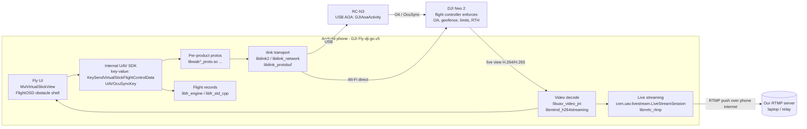

# REA investigation: how DJI Fly flies the DJI Neo 2

> **Legal and ethical scope.** Zak owns the DJI Neo 2, the Android phone and the DJI Fly install. The APK (DJI Fly **1.21.18**, package `dji.go.v5`, SHA-256 `a4d0bcfb6be9731bcc07dc66b67a3492c770ceda9d0fa94ec247df2889be8a0d`) was downloaded only from DJI's official download page. The analysis is for **interoperability** under UK law (CDPA 1988 s.50B). No firmware was touched or analysed. No DJI safety feature (obstacle sensing, geofencing, altitude/speed limits, RTH) was bypassed or disabled. No encryption or authentication was circumvented, nothing was decrypted, and no DJI code is redistributed: this repo holds **names only** (packages, classes, library names, identifier strings), never decompiled bodies. Findings are architecture-level. Before any commercial use: review DJI's terms and get legal advice.

**Tooling:** [REA](https://github.com/morluto/rea) 6.8.0 (`rea-agents`) with its JADX provider (JADX 1.5.6 + `jadx-headless-mcp` 0.7.1) on OpenJDK 17 / Node 22.23.4. Setup: [`rea/setup.sh`](../../rea/setup.sh). Raw evidence (name lists, each < 200 lines): [`evidence/`](evidence/). Exact commands and provenance: [`README.md`](README.md).

## TL;DR verdict

**Direct code control of the Neo 2 is not feasible within our guardrails.** DJI Fly drives the Neo 2 through DJI's private, product-specific native stack (`libilink*`, per-product `lib*_proto.so`, an internal key-value "UAV SDK" with `KeySendVirtualStickFlightControlData`). None of it is a public API; MSDK v5 does not support the Neo series and DJI says there are no plans to add it. Reaching that stack would mean replicating a private protocol, very probably including its authentication/encryption, which is out of scope.

**Video is legitimately available today**: DJI Fly's built-in **RTMP live streaming** (Transmission → Live Streaming Platforms → RTMP) pushes the Neo 2 feed to any RTMP server, including one on our laptop. **Recommended path:** Neo 2 = flown manually, live video over official RTMP into `drone/LiveFeedDriver`; autonomy runs in `SimDriver` now; real autonomy on a **Ryze Tello EDU** (open Wi-Fi SDK, indoor demo) or **DJI Mini 4 Pro + MSDK v5** (product path, simulator first).

## 1. How DJI Fly talks to the Neo 2

The Neo 2 has two links ([DJI spec](https://www.dji.com/global/neo-2/specs)): **standard Wi-Fi video transmission** straight to the phone (Wi-Fi 500 m; phone-only flying is capped at 60 m and uses on-screen virtual sticks), and an **optional O4 (OcuSync) Digital Transceiver** for the RC-N3 / goggles (up to 10 km FCC). The APK carries both paths.

| Layer | Evidence in the APK (names only) | Interpretation |
| --- | --- | --- |
| Phone ↔ drone Wi-Fi | `com.uav.service.wififast.ui.shield.WifiControlConnectActivity`, `com.uav.component.fpv.connection.WifiControlReConnectActivity`, `WifiFastMultiLinkShieldActivity`, `WiFiFastGuideActivity` (manifest) | Dedicated "Wi-Fi control" connection flow (phone joins the drone's AP) plus a "Wi-Fi fast" media-transfer path |
| Phone ↔ RC-N3 (USB) | `com.dji.component.application.activity.DJIAoaActivity` on `android.hardware.usb.action.USB_ACCESSORY_ATTACHED`; USB accessory feature required | RC-N3 attaches as an Android Open Accessory over USB; the RC then carries O4/OcuSync to the drone |
| OcuSync / O4 | `Luav/sdk/keyvalue/key/UAVOcuSyncKey`, `OcuSyncLink`, `OCUSYNC` (strings in `libdatajar.so`) | Link state/config surfaced as keys in an internal key-value SDK |
| Transport / link | `libilink2.so`, `libilink_network.so`, `libilink_protobuf.so`, `libilink_live.so`, `liblinkid.so` | DJI's internal "ilink" transport, protobuf-framed messaging, live-video channel |
| Product protocol | `libwab020_proto.so` … `libwab530_proto.so`, `libacb20x_proto.so`, `libhgb212_proto.so`, `liboqb101_proto.so`, `libwmb261_proto.so`, `libassemble_proto.so` | One protobuf/proto library per product/board code. Which code is the Neo 2 is **not** established |
| Flight commands | `KeySendVirtualStickFlightControlData`, `KeyVirtualStickControlModeEnabled`, `com/uav/component/fpv/mvi/slots/widgets/virtualcontrol/MviVirtualStickView` | On-screen sticks feed a "virtual stick" key in the internal SDK, then down the link. Safety limits are enforced in the aircraft's flight controller, not in the app |
| Geofencing | `libflightrestrictcore.so` | App-side flight-restriction (GEO zone) data; untouched |
| Video in | `libuav_video_jni.so`, `libmtmd_h264streaming.so`, `libmtmd_xplat_codec.so` | Native H.264/H.265 live-view receive + decode, surfaced to Java via JNI |
| Video out (official) | `libmrtc_rtmp.so`, `libsdk_liveshare_core.so`, `Lcom/uav/livestream/LiveStreamSession`, `.../core/video/LiveStreamVideoEncoder`, `.../core/audio/LiveStreamAudioEncoder` | The built-in RTMP live-streaming feature |
| Public SDK | REA `search-android-classes ... dji.sdk` → **no match**; no `dji.v5` public API | DJI Fly does not embed the public MSDK; it uses a private `uav.sdk` key-value layer |
| Product name | `NEO2` (string in `libdatajar.so`) | Neo 2 is a known product type in the shared stack |

Note: the Java layer visible to REA is thin (984 top-level classes in one `classes.dex`, mostly third-party); most DJI identifiers appear as strings inside native libraries (`libdatajar.so` looks like a packed Java/data container). We did not unpack it: we identify, we don't extract.

## 2. Officially exposed ways to get video / telemetry out

| Path | Status for Neo 2 | Use in Sentinel |
| --- | --- | --- |
| **RTMP live streaming** (DJI Fly → ⋯ → Transmission → Live Streaming Platforms → RTMP) | Supported on the Neo series ([DJI Fly livestream guide](https://support.dji.com/help/search?keyword=DJI+Fly), [Neo RTMP how-to](https://bliksund.com/blog-and-news/how-to-set-up-rtmp-streaming-on-the-dji-fly-app-for-the-dji-neo-drone-fpv-drone-guide)); code evidence above | **Primary.** `drone/LiveFeedDriver` ingests `rtmp://<laptop>:1935/live/neo2` via ffmpeg/MediaMTX |
| Phone screen mirror (USB `scrcpy` / capture card) | Works with any app; no DJI feature needed | Fallback if RTMP isn't reachable |
| Wi-Fi fast transfer / QuickTransfer (`com.uav.service.wififast.*`) | Official, post-flight media download (up to 80 MB/s) | Offline twin capture (COLMAP) from recorded 4K |
| Flight records (`Android/data/dji.go.v5/files/FlightRecord/DJIFlightRecord_*.txt`) | Written after each flight; **encrypted**; parse only via DJI's official [FlightRecord parsing API / key](https://developer.dji.com/policies/flight_record/) | Post-flight telemetry (path, attitude, battery) if we apply for a key — not live |
| MSDK v5 | **Not supported** for Neo / Neo 2; DJI: "no relevant support plans" ([MSDK issue #725](https://github.com/dji-sdk/Mobile-SDK-Android-V5/issues/725), [supported list](https://developer.dji.com/doc/mobile-sdk-tutorial/en/)) | Use a Mini 4 Pro / Mini 3 / Mini 3 Pro instead |

**RTMP network gotcha (important for the demo).** The stream leaves via the *phone's* internet, not the drone. In **Wi-Fi mode** the phone's Wi-Fi is occupied by the drone's AP, so the push goes over **4G/5G**: point it at a public RTMP relay or a TCP tunnel to the laptop (e.g. `cloudflared`/`ngrok` TCP on 1935). With the **RC-N3**, the phone talks to the RC over USB, so its Wi-Fi is free to join the laptop's LAN and push straight to `rtmp://<laptop-lan-ip>:1935/...`. Expect ~1–3 s latency; fine for bay checks at 1–2 Hz.

## 3. Depth / LiDAR / obstacle data (`depth_data`)

The Neo 2 has an omnidirectional monocular vision system, a **forward-facing LiDAR** and a **downward infrared (ToF) sensor** ([user manual §4.4](https://downloads.ctfassets.net/wl6a3py7hwd8/3xw8PBU2FsOYbIZxLOcRjF/f212fd987c56d5622b42aed24798bdeb/DJI_Neo_2_User_Manual_v1.0_en.pdf)).

**Does DJI Fly receive depth data?** It receives **processed obstacle distances**, not raw depth. Names in the shared native stack ([`evidence/depth.txt`](evidence/depth.txt)):
- `libdatajar.so`: `AllDirectionsObstacleDistanceInfoByteArray`, `AllDirectionsObstacleDistanceInfoConverter`, `OmniHorizontalRadarDistance`, `OmniUpRadarDistance`, `OmniDownRadarDistance`, `OmnidirectionalRadarStatus`, `RadarObstacleInfo`, `ObstacleDetectionSector`, `ObstacleDetectionSectorWarning`, `ObstacleWarningMinDistance`, `obstacleDistanceInMeters`, `downObstacleDistance`, `BaseFlightOSDTopObstacleVisionShell` / `AndroidSdrFlightOSDTopObstacleVisionShellModel`.
- `libsdk_jni.so`: an observer for `perception_birdview_distance_push`.
- `libfr_engine.so`: `FlightRecordEngine::UpdateObstacleDistances`, `EnablePerceptionGroupDataRecord`; `libfr_std_cpp.so`: `PerceptionObstacleDistances`, `PerceptionState`.

Interpretation: the aircraft's perception module pushes a per-sector **distance array** ("bird-view"/"radar" = the on-screen obstacle radar ring, not a radar sensor), which the app renders as the OSD obstacle-vision overlay and warnings, and may write into flight records. These names are shared across DJI Fly products; that the Neo 2 emits every field is **not verified** (no aircraft runtime was examined). No point-cloud, depth-map or raw LiDAR return type was found.

**Officially exposed?** Only as **UI** (obstacle warnings / radar display in live view) and, at most, as fields inside the **encrypted flight record**, readable post-flight via DJI's official parse API. There is **no live, official export** of Neo 2 depth/obstacle data. The official live route to obstacle distances is MSDK v5's perception API on a supported aircraft (e.g. Mini 4 Pro). For Sentinel, depth comes from **our own twin** (COLMAP) and monocular estimates on the RTMP video.

## 4. Feasibility verdict and recommended integration

| Option | Feasible? | Why |
| --- | --- | --- |
| Code control of Neo 2 via DJI Fly's private stack | **No** (within guardrails) | Private, per-product protocol; likely authenticated/encrypted; no SDK; replicating it risks ToS/legal and safety |
| Neo 2 via MSDK v5 | **No** | Not supported, no plans |
| Neo 2 live video via official RTMP | **Yes, today** | Built-in feature, no RE needed |
| Neo 2 telemetry live | **No** (post-flight via encrypted records + official parser only) | |
| Autonomy in sim (`SimDriver`) | **Yes, today** | Same `DroneDriver` interface, code safety supervisor |
| Real autonomy: Tello EDU | **Yes** (indoor demo) | Open UDP SDK, mission pads; discontinued 2024 |
| Real autonomy: Mini 4 Pro + MSDK v5 + RC-N3 | **Yes** (product path) | Official virtual stick, perception, live video; DJI simulator first |

**Recommended:** fly the Neo 2 manually (label it "piloted") and stream it with DJI Fly RTMP into `LiveFeedDriver` → Decisions API bay checks on the twin; run patrol autonomy in `SimDriver`; the Devin mission agent plans patrols, never flies. Next hardware: Tello EDU for indoor autonomy, Mini 4 Pro + MSDK v5 (`MsdkBridgeDriver`) for the product.

## Limitations

Static, name-level analysis of one APK version. Names don't prove runtime use, product mapping (which `wab*` is the Neo 2) or wire format. No device traffic was captured and no aircraft was connected. A next step that stays in scope: capture our own phone's traffic with REA's HAR/mitmproxy support to confirm the RTMP path only.
