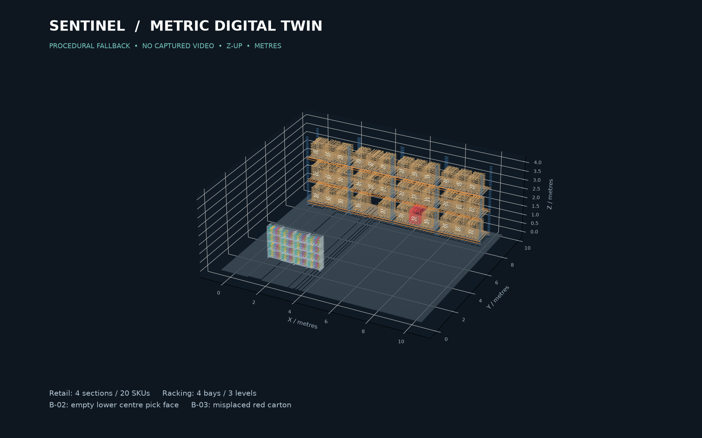

# W4 — Metric digital twin

The committed `out/` assets work immediately: **214,658 points**, one retail unit
with four sections and 20 distinct SKUs, and four 4-metre-high rack bays. Racks have
blue uprights, orange beams, decks and labelled cartons. **B-02** has one empty
lower-centre pick face; **B-03** has a misplaced red carton. These are **synthetic
demo geometry**, not a scan or an AI finding. Geometry comes from the fixed
`config/site.yaml`; no other workstream's files are changed.



## Quick start (repository root, Python 3.11+)

```sh
python3 -m venv twin/.venv
twin/.venv/bin/pip install -r twin/requirements.txt
twin/build.sh --boxes
```

The bundled assets need **no Python, OpenAI key, GPU or network** to render in
the dashboard. Re-generation needs only the base requirements above. Tested on
Ubuntu, Python **3.12.13**, COLMAP **3.7 CPU**, Open3D **0.19.0**.

### Dashboard handoff

Serve/copy `twin/out/` as static files. Prefer `twin_points.bin` or load
`scene.glb` as an alternative (do not draw both on top of each other).

- `twin_points.bin`: **little-endian Float32**, **24 bytes per point**, interleaved
  `[x,y,z,r,g,b]`; colours are normalized sRGB **0..1**, not 0..255. No header.
  Build a `THREE.InterleavedBuffer(new Float32Array(buffer), 6)` and attributes
  `position` (offset 0, itemSize 3), `color` (offset 3, itemSize 3).
- `twin.ply`: binary little-endian PLY; XYZ Float32 and RGB uint8.
- `scene.glb`: named procedural mesh objects, no external textures. Coordinates
  are deliberately the **same Z-up twin coordinates** as the binary cloud.
  If the dashboard uses a Y-up scene, put **all** twin objects, zones and
  drone positions in one consistently rotated parent; do not rotate only GLB.
- `twin.json`: fixed contract keys `source`, `point_count`, `bounds_min`,
  `bounds_max`, `floor_plane`, plus provenance, object bounds and planted issues.
- Right-handed, **metres**, +Z up; floor surface at **z=0**. The floor slab
  extends to -0.06 m; this is deliberate, not an anchoring error.
- All assets are **<20 MB each**, cloud capped at **300,000** points using voxel
  averaging (initial voxel 0.035 m; coarsens automatically to satisfy the cap).

## One-command footage build

```sh
sudo apt-get update && sudo apt-get install -y ffmpeg colmap
twin/.venv/bin/pip install -r twin/requirements-reconstruction.txt
twin/build.sh /absolute/path/to/warehouse.mp4
```

This runs `extract_frames.py` → `reconstruct.sh` → `anchor.py` → `floor.py` →
`export.py`, writes diagnostics under ignored `twin/work/capture-*/`, then
publishes complete dashboard assets. If reconstruction/metric alignment/floor
fitting fails, it produces the labelled box fallback and records
`fallback_reason` in `twin.json`. **Exit 0 means usable assets, not necessarily a
successful scan:** check `twin.json.source == "colmap"` for that. Missing input
or invalid usage exits nonzero. No video is uploaded or committed.

Default extraction: **2 fps**, max **160 frames**, max width **1600 px**, aspect
ratio retained (4K is never sent to COLMAP at full resolution). If the clip is
longer than 80 s, sampling is automatically spaced across its **whole duration**
instead of taking only the start. Frames whose grayscale **Laplacian variance
is <50** after resizing are discarded; `frames.json` records every score/rejection.
This is a conservative blur/low-texture heuristic, not a sharpness guarantee.
If fewer than three sharp frames remain, the script falls back and prints advice.
Override with `TWIN_FPS`, `TWIN_MAX_FRAMES`, `TWIN_MAX_WIDTH`,
`TWIN_BLUR_THRESHOLD` (0 disables blur rejection). For an unchanging
camera/lens, COLMAP uses one shared SIMPLE_RADIAL camera and sequential matching.
Take a slow, well-lit translating walkthrough, avoid motion blur, moving people,
digital zoom and featureless/repetitive surfaces; include the floor and portals.

CPU COLMAP runs sparse SfM; **CUDA is not needed**. `automatic_reconstructor`
is forcibly time-boxed to **1,500 s / 25 minutes**, including feature extraction,
matching and mapping. `COLMAP_TIMEOUT_S` may shorten but cannot exceed 1,500;
`COLMAP_THREADS=4`, `COLMAP_USE_GPU=0` are defaults. On CPU, sparse output is a
thin point cloud, not a dense mesh. Dense PatchMatch on COLMAP 3.x requires CUDA;
a Modal GPU would improve dense output, but is not a demo prerequisite.

### How to film with the Neo 2

- Use **4K onboard recording**, download the original `.mp4` through **DJI Fly on
  Android**, then copy it to the laptop. Use the original file, not a screen
  recording, chat-app recompression or live stream.
- In the **empty warehouse**, have a qualified pilot fly a **slow translating lap**
  with the camera facing shelves/racks and some floor. Aim for **2–3 m altitude
  only where safe and permitted**, and keep ≥70–80% visual overlap between sampled
  views. Slow down at turns, avoid stationary yaw-only pans, motion blur and zoom
  changes. Good diffuse lighting and textured racks help; avoid reflective or blank
  floors filling the frame. No autonomous mission is needed for this capture.
- Before filming, place **printed QR portals** on the **floor and rack ends** at the
  measured poses in `config/site.yaml`. P0/P1 have **0.20 m code edges**, P2/P3
  **0.30 m**; edge length means the black QR boundary, **not** the paper/quiet-zone
  margin. P0 is on the floor at the origin; P1/P2/P3 are on vertical rack/shelf ends
  at **z=1.5 m**, facing -Y. Do not guess a relocated portal's pose.
- Pass each portal slowly from multiple separated viewpoints. Keep it sharp,
  unobstructed and large enough to decode (**ideally ≥100 pixels across after
  downscaling**). Capture rack geometry continuously between portal views.
  A single stationary view cannot determine scale by triangulation. Without
  portals, survey at least three widely spaced, non-collinear points instead.
- Preserve DJI obstacle sensing, geofencing, altitude/speed limits and
  return-to-home; follow the pilot's indoor operating procedure. Do not bypass
  safeguards or fly near people for the sake of a better scan.
- Run `twin/build.sh /path/to/neo2-warehouse.mp4`. It prints retained/blurred frame
  counts, the chosen sampling rate, and QR/manual anchoring next steps. If it
  falls back, keep the `work/capture-*` directory so a manual survey can finish
  anchoring **without another COLMAP run**.

### Metric anchoring: never guess the scale

**Portal route (automatic):** print QR payloads exactly `P0`, `P1`, `P2`, `P3`
(or `sentinel:P1`, etc.) at the configured physical edge lengths and measured
poses. Keep a portal visible in at least two registered frames with camera
translation. `portals.py` decodes corners, undistorts using COLMAP intrinsics,
triangulates in COLMAP space, checks positive depth and ≥1° parallax, and fits
a proper scale/rotation/translation to the known world corners. SIMPLE_PINHOLE,
SIMPLE_RADIAL, RADIAL, PINHOLE and OPENCV camera models are supported. Portal
origin is its centre; local corner order is top-left, top-right, bottom-right,
bottom-left viewed head-on (local +Y up, +Z out of the code).

**Manual route:** when footage has no known portals, pick **at least three
non-collinear** COLMAP points in `work/capture-*/colmap/raw.ply` using a point
cloud viewer, and survey their corresponding twin XYZ positions in metres.
Prefer widely spaced points; more than three lets RMSE reveal bad picks.
Create a JSON inside `twin/work/`, like:

```json
{"pairs": [
  {"colmap": [1.1, 2.2, 3.3], "twin": [0.0, 0.0, 0.0]},
  {"colmap": [4.1, 2.2, 3.3], "twin": [10.0, 0.0, 0.0]},
  {"colmap": [1.1, 4.6, 3.3], "twin": [0.0, 8.0, 0.0]}
]}
```

Those numbers illustrate the **format only**, not real survey data. Do not use
the example file for real footage. Supplied picks can use measured portal
corners as `{"portals":[{"id":"P1","colmap_corners":[[x,y,z],...] }]}`.

```sh
# Keep COLMAP's selected raw model and align without repeating reconstruction:
work=twin/work/capture-REPLACE_ME
twin/.venv/bin/python -m twin.anchor "$work/colmap/raw.ply" \
  --alignment twin/work/my-survey.json --out "$work/anchored.npy"
twin/.venv/bin/python -m twin.floor "$work/anchored.npy" --out "$work/floored.npy"
twin/.venv/bin/python -m twin.export "$work/floored.npy" --out twin/work/metric-out

# Or provide picks for a new complete run (the mapping must match that run):
TWIN_ALIGNMENT=twin/work/my-survey.json twin/build.sh warehouse.mp4
# Equivalent positional option:
twin/build.sh warehouse.mp4 twin/work/my-survey.json
```

`anchor.py` rejects collinear/insufficient picks and RMSE above **0.15 m**.
`floor.py` uses Open3D RANSAC near the anchored z=0 (±0.30 m, distance threshold
0.03 m), requires ≥30 inliers and a near-horizontal normal, then refines the
cloud to z=0. It refuses walls/unsupported floors; it never writes `site.yaml`.
The refinement matrix is recorded alongside the anchor transform so corrections
are auditable. This is a heuristic refinement, **not surveyed-accuracy certification**;
visually verify floor/portal alignment before a real capture or safety use.

### Stock input actually exercised

```sh
twin/download_stock.sh
twin/build.sh twin/work/warehouse.mp4
```

[Man Working inside the Warehouse](https://www.pexels.com/video/man-working-inside-the-warehouse-4292299/)
by **Tiger Lily**, 1920×1080, 25 fps, **8.84 s**, 5,525,400 bytes. Downloaded
directly from Pexels' public CDN after its search/page returned an access challenge.
The [Pexels licence](https://www.pexels.com/license/) permits free use/modification;
attribution is appreciated, and the footage must not imply endorsement. This
is a short moving warehouse shot with a worker, not an ideal survey walkthrough.
The initial 1280 px, unfiltered run extracted **18 frames**, registered **18 images**
and produced **2,313 sparse points**. With the Neo 2 defaults (1600 px, blur variance
threshold 50), **9/18** frames survived, **9 images** registered and **1,232 points**
were reconstructed in the final smoke run (297 in a previous run; COLMAP's
initialization varies). This illustrates the overlap/blur-threshold trade-off; use
the frame scores and a slower, sharper capture rather than assuming a threshold
is universally appropriate. There are **no Sentinel portals or measured dimensions**
in this stock clip, so the pipeline correctly refused to invent metric scale
and retained the procedural twin. The clip stays local in ignored `work/`.
No NVIDIA SimReady models were needed: committed geometry is entirely generated
by this code, with no third-party asset licence or downloads required.

## Tests and checks

```sh
twin/.venv/bin/pip install -r twin/requirements-dev.txt
twin/.venv/bin/python -m pytest -q twin/tests
twin/.venv/bin/ruff check twin
twin/.venv/bin/ruff format --check twin
twin/.venv/bin/mypy twin --config-file twin/pyproject.toml
bash -n twin/build.sh twin/reconstruct.sh twin/download_stock.sh
```

Tests cover normalized/bounded exports, binary byte layout and PLY roundtrip,
committed scene geometry/issues, deterministic generation, exact Sim(3), manual
picks, floor RANSAC rejecting walls, bounded ffmpeg extraction, COLMAP camera/pose
parsing, triangulation and **real OpenCV QR decoding of synthetic perspective views**
through metric alignment. Reconstruction itself was additionally exercised on
the downloaded stock clip as described above. No API keys are used by this folder.

These are **offline scene-generation tools only**: no firmware, flight-control,
DJI sensing, geofencing, return-to-home or other safety settings are changed.
